<p align="center">
  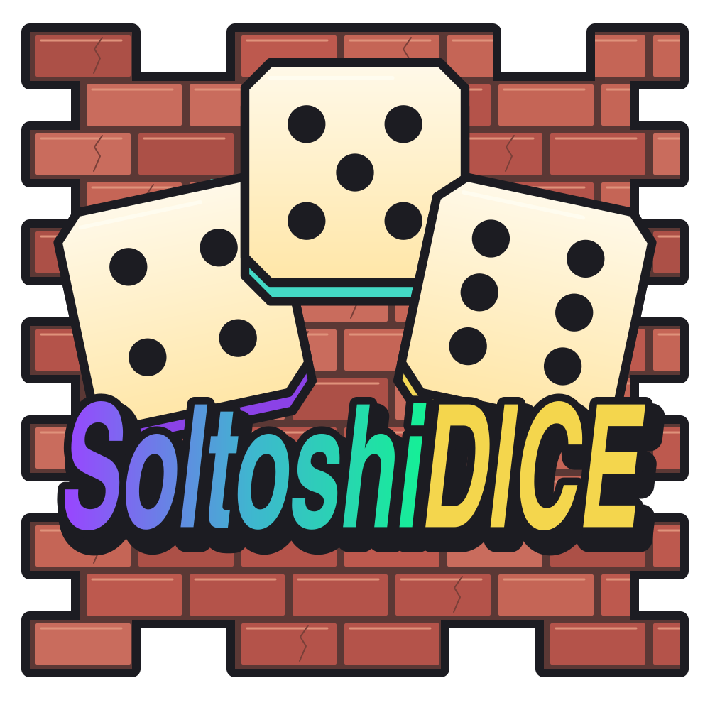
</p>

# SoltoshiDICE

**A shared 3D courtyard for Solana games, a community-funded bank, and token-backed perpetual markets.**

Play Cee-lo, Hold’em, blackjack, slots, Street Fights and rock, paper, scissors in one social space. The browser draws the world; wallets authorize actions; Solana programs enforce the relevant custody, rules and settlement. SDICE Perps is a separate application linked from the courtyard.

[Play](https://soltoshidice.wtf/) · [Perps](https://soltoshidice.wtf/perps) · [Verification hub](https://soltoshidice.wtf/verification) · [Build instructions & release evidence](VERIFICATION.md) · [Security reporting](SECURITY.md)

<p align="center">
  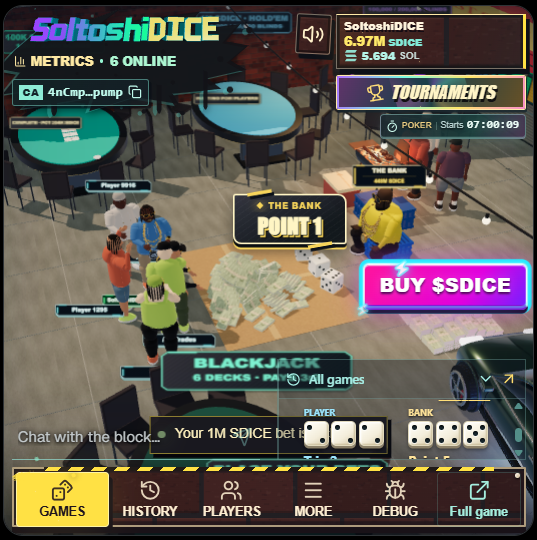
  <br><sub>Courtyard UI captured October 7, 2026. Displayed balances and player counts are historical.</sub>
</p>

This public repository contains the released Solana program source, reproducible-build records and read-only verification tools. The overview below also explains the wider platform; the website, 3D clients and hosted services are not included in this contract-source export. All README images are stored here and are publicly accessible.

This overview reflects recorded releases through **October 23, 2026**, with screenshots captured October 24. The bank program is immutable; poker, fights, RPS, brackets and Perps remain upgradeable. [Program records](programs.json), exact verified source revisions and [release receipts](VERIFICATION.md) take precedence over historical feature notes.

**Explore:** [Games](#the-games) · [Competitions](#competitions) · [Community bank](#the-community-bank) · [Architecture](#server-and-chain-architecture) · [Verification](#what-can-be-verified) · [Code map](#find-your-way-around) · [Reproduce the builds](#reproduce-independently)

## The games

Actual browser screenshots show each game's interface; the diagrams underneath explain its transaction flow. The six courtyard games were captured from local previews using the real game components and simulated state. Perps was captured from the live trading page in a fresh, unfunded browser session. All captures are from **October 24, 2026**; displayed prices, balances and results are illustrative or historical, not live data or settlement evidence. [Screenshot sources and timestamps](docs/assets/screenshots/README.md).

### Cee-lo — one bank, one shared round

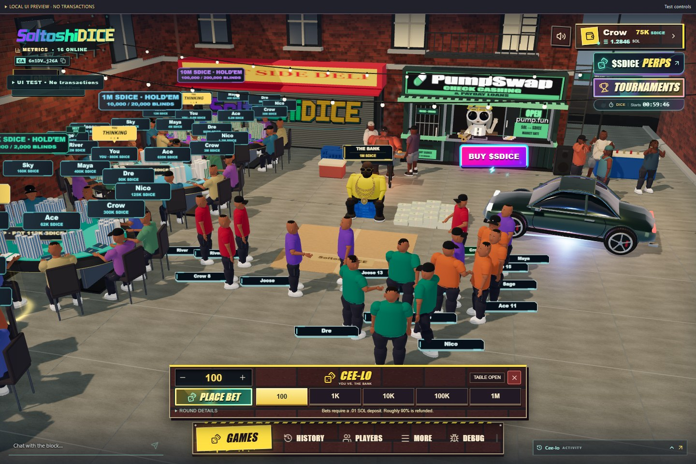

*The Cee-lo wager panel in the shared courtyard — local UI preview.*

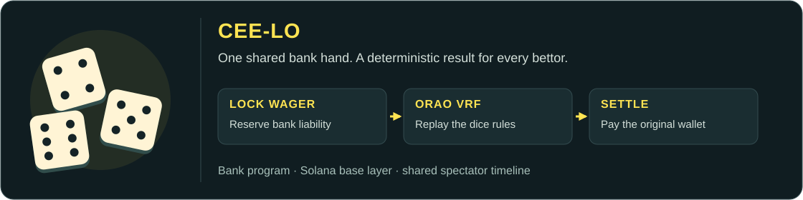

The first accepted wager opens a 60-second betting window. The bank rolls first; eligible players then roll in acceptance order. Everyone watches the same timeline, and a disconnected bettor still receives the result of an accepted wager.

- **Rules:** triples, 4–5–6, points and 1–2–3 determine the result. The bank wins ties; versioned rules define instant wins, rerolls and refunds.
- **Implementation:** the bank program binds ORAO randomness to the round and derives deterministic bank/player dice streams. It reserves maximum payout liability when accepting each bet.
- **Settlement:** program instructions pay the original wallet; objective oracle timeouts permit refunds. The keeper advances transactions, while the scene replays their results.

[Native shared-round rules](games/chain/program/src/shared.rs) · [ORAO adapter](games/chain/program/src/orao.rs) · [Cee-lo replay verifier](verification/verify-fairness.mjs)

### Texas Hold’em — private cards, public pots

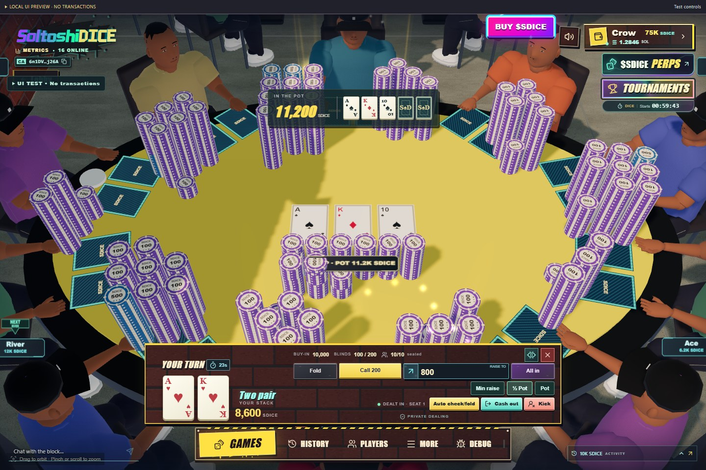

*A player's view of the flop, private cards and betting actions — local UI preview.*

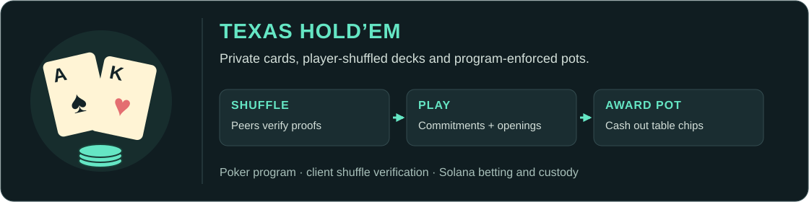

Cash poker and scheduled tournaments share the dealing engine. Production has **four ten-seat tables and a 40-player tournament capacity**. The separate 100-player candidate is devnet work, not the deployed game.

- **Private dealing:** players shuffle and mask cards using Ristretto255 mental poker. Browsers verify shuffle proofs; Solana checks committed card openings, legal betting, side pots and awards.
- **Recovery:** remaining players can reconstruct a missing player's due board keys after a grace period, subject to the all-but-one threshold. Hole-card keys are not threshold-shared. The client preserves private hand keys and retries uncertain submissions.
- **Custody:** chips live in poker escrow. Winning a pot credits a table balance; withdrawing that balance is a separate cash-out transaction.

[Poker program](games/poker/programs/riverproof/) · [Mental poker cryptography](games/poker/mental/) · [AFK recovery release](evidence/poker-afk-release-2026-10-22.json) · [Verification coverage](verification/games/poker.json)

### Blackjack — a shared dealer and bank-backed hands

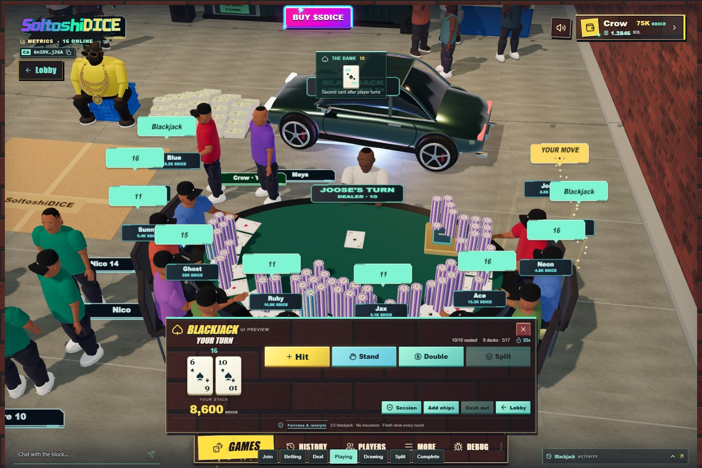

*The shared dealer table and player action panel — local UI preview.*

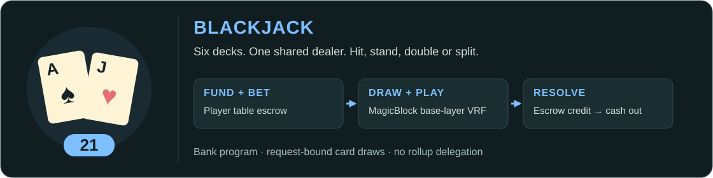

Ten seats share a dealer and six decks. Players can hit, stand, double and split. Naturals pay 3:2, other wins pay 1:1, ties push, and the dealer stands on soft 17. The documented no-hole-card rules return added split/double stakes on dealer blackjack.

- **Cards:** authenticated, request-bound **MagicBlock base-layer VRF** supplies card draws. This game does not use ephemeral rollup delegation.
- **Rules and funds:** the bank program enforces actions, hand resolution, table escrow and payouts. The blackjack coordinator progresses permitted actions and timeouts.
- **Wallet flow:** scoped sessions reduce repeated approvals; a table result and a wallet cash-out remain distinct steps.

[Blackjack rules](games/chain/program/src/blackjack/rules.rs) · [VRF adapter](games/chain/program/src/blackjack/magicblock.rs) · [Verification example](verification/games/blackjack.json)

### Lucky Block — three-reel slots

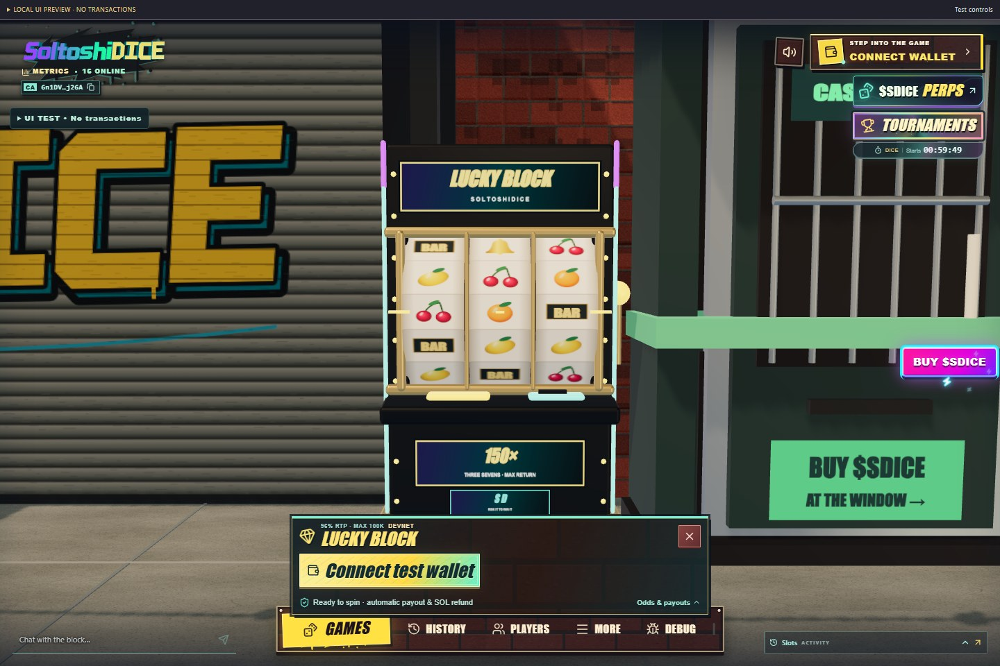

*The Lucky Block cabinet and production game controls — offline UI preview, wallet disconnected.*

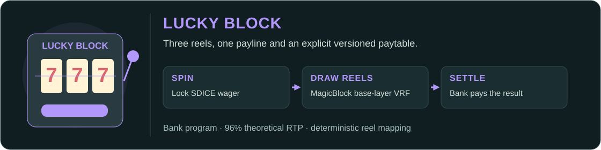

Three reels, one payline and a versioned paytable. The model has **96% theoretical RTP** across its complete outcome space: a long-run mathematical property, not a return promised for a player's session.

- **Outcome:** MagicBlock base-layer VRF is bound to the spin. Matching Rust and TypeScript rules map the output to reels and payout.
- **Settlement:** the bank program accepts wagers, settles rewards and winnings, and supports expired-spin refunds and temporary-account rent recovery.
- **Presentation:** the 3D cabinet animates the recorded result. Animation does not select the payout.

[Reproducible reel rules](games/chain/slots-rules/src/lib.rs) · [Bank slots implementation](games/chain/program/src/slots/) · [Verification example](verification/games/slots.json)

### Street Fights — challenge, accept, watch the result

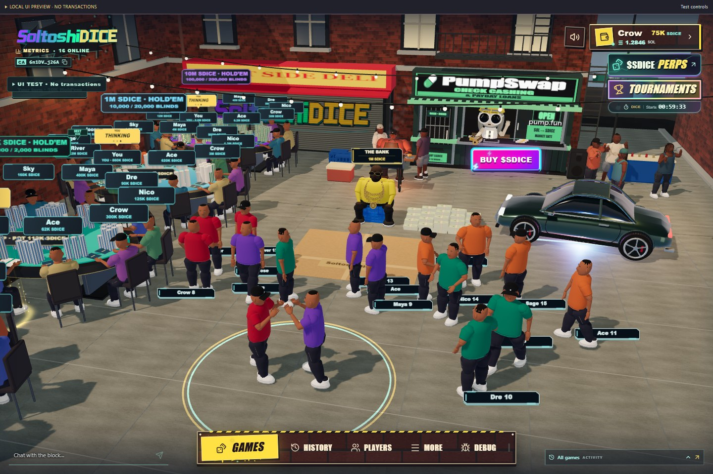

*Combat playing out in the courtyard — local replay of a recorded fixture.*

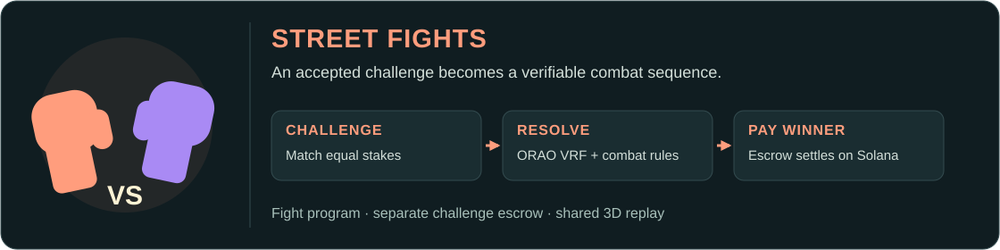

Two players escrow equal SDICE stakes and watch a combat sequence in the courtyard. A separate fight program holds challenge funds; the community bank is not the opposing player.

- **Outcome:** a fresh, fight-bound ORAO request feeds deterministic combat rules.
- **Payout:** ordinary cash challenges pay 99% of the pot to the winner and 1% to the bank. Tournament prize rules are separate.
- **Presentation:** the coordinator publishes verified results and payment links; players and spectators can watch or replay the fight without controlling its outcome.

[Fight program](games/fights/fight-program/) · [Combat rules](games/fights/fight-program/src/combat.rs) · [Verification example](verification/games/fights.json)

### Rock, paper, scissors — hidden choices, then reveal

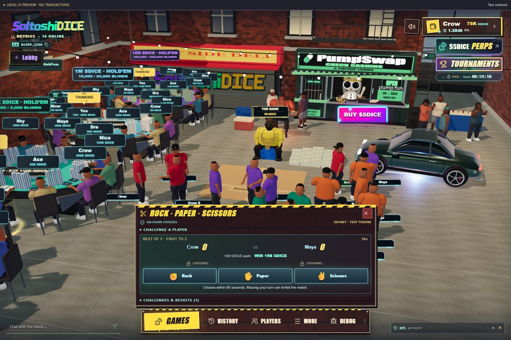

*The match panel before either player reveals a move — local UI preview.*

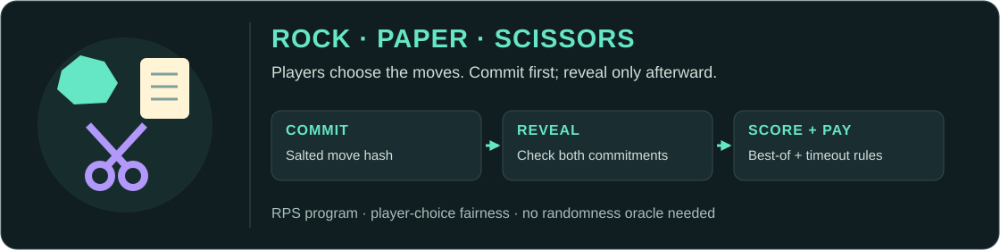

Players choose their own moves in best-of-1, 3, 5, 7 or 9 challenges. This is a **commit–reveal game**, not an oracle-selected outcome.

- **Commit:** each move is hashed with a random salt and its match/player/round context. Neither player can reveal until both commitments exist.
- **Reveal:** the program verifies signed authorizations and checks moves against commitments. Ties replay; timeouts and forfeits follow native rules.
- **Settlement:** separate escrow pays the winning cash challenge, with the same 99% winner / 1% bank split. Unrevealed secrets stay in the player's browser.

[RPS program](games/chain/rps-program/) · [Native rules](games/chain/rps-program/src/rules.rs) · [Verification example](verification/games/rps.json)

### SDICE Perps — a separate trading application

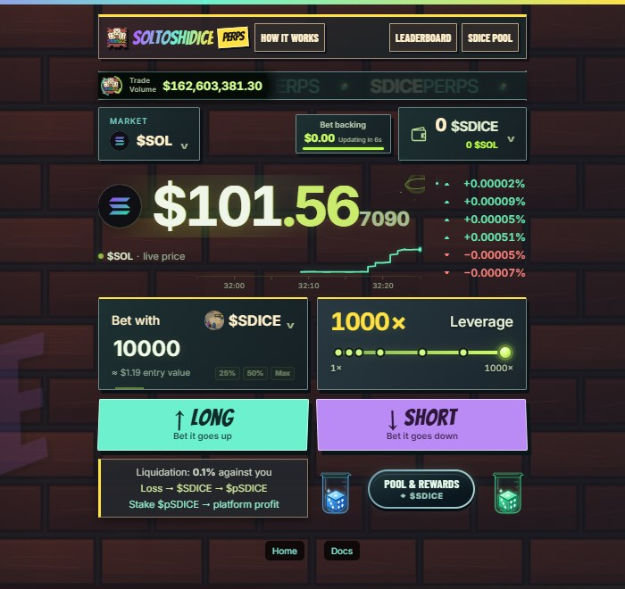

*The live Perps trading interface, captured without funding or placing a position. Prices are historical.*

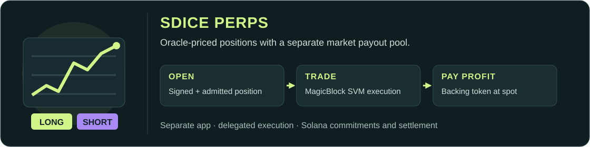

Perps offers oracle-priced long/short positions, token-backed payout pools and non-transferable pool rewards. Its browser application and backend are separate from the courtyard. This repository includes the [released Perps contract source](perps/), its build configuration and public evidence.

- **Execution:** selected Solana accounts are delegated to MagicBlock's SVM Ephemeral Rollups. Signed instructions execute there; commitments and settlement return to Solana mainnet. ER execution and base-layer finality are distinct stages.
- **Backing:** the Bet backing reserve can combine the market token, SOL and USDC. A position still wagers one selected collateral token. Native SOL- and USDC-backed market creation is supported.
- **Profits:** profits are paid in the market's backing token at its USD spot price **when paid**, without a final swap to USDC. Payout-pool spot value also drives reward tapers and position limits. The Bet backing reserve is separate accounting.
- **Service role:** a shared market worker handles pricing and lifecycle work. Opening positions requires operator-managed admission; price freshness, worker/validator availability and upgrade authority remain dependencies.

[Mixed-backing release](evidence/perps-mixed-backing-release-2026-10-23.json) · [Spot-payout release](evidence/perps-spot-payout-release-2026-10-21.json) · [Delegation evidence](verification/games/perps-delegation.json) · [Public payout guide](https://soltoshidice.wtf/perps/docs/learn/lp-queue#spot-payouts)

## Competitions

Three competition systems share tournament navigation and stacked start/end timers, with different scoring and custody models.

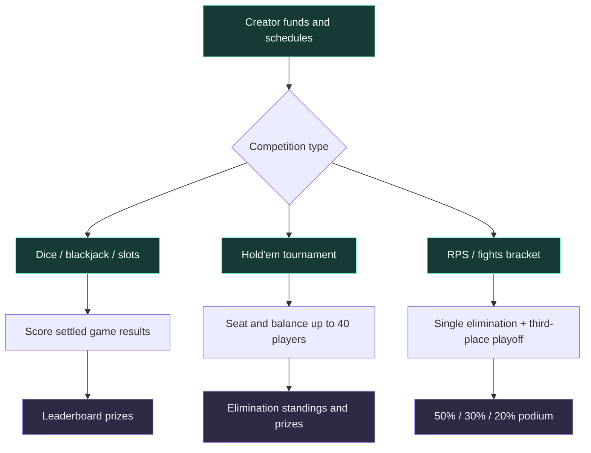

| Competition | How it works | Technical reference |
| --- | --- | --- |
| World Series of Dice, blackjack and slots | Separate game leaderboards score eligible settled wins. Minimum sponsored prize **100K SDICE**; **1–24-hour** duration; start now or at most **24 hours ahead**. | [Bank tournament rules](games/chain/program/src/tournament/) |
| Hold’em | Scheduled entry, table seating/balancing, elimination and prize settlement. Production remains four tables / **40 players**. | [Poker tournament program](games/poker/programs/riverproof/src/tournament/) |
| RPS and fights | Separate events for each game, **2–100 players**, selectable best-of matches, minimum **100K SDICE** sponsored prize. Entry fees join the prize; third place is decided by a playoff. Registration closes 15 minutes after the scheduled start. | [Bracket rules and receipts](brackets/README.md), [program](brackets/chain/bracket-program/) |

Brackets have their own program and keeper; they do not resize or replace poker. A two-player bracket pays 70% / 30% because there is no third-place finisher.

## The community bank

The bank supplies pooled SDICE liquidity for Cee-lo, blackjack and slots. Stakers own bank shares; their equity changes with bank assets and game outcomes. Lock tiers change **reward weight**, not ownership percentage.

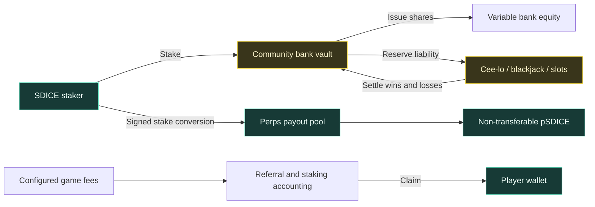

The **bank upgrade authority was permanently revoked** on October 20, 2026, America/Denver. Remaining admin operations are constrained by that immutable code: for example, future wager-limit changes, table configuration and available house SOL-reserve withdrawals. The old version-1 general token-withdraw instruction rejects the current version-4 bank. Stake-to-Perps conversion requires the stake owner's signature, including for locked and Forever stakes.

[Revocation receipt](evidence/bank-upgrade-authority-revocation-2026-10-21.json) · [Bank instructions](games/chain/program/src/lib.rs) · [Stake-to-Perps implementation](games/chain/program/src/economy/perps_contribution.rs) · [Authority guide](https://soltoshidice.wtf/verification#authority-status)

## Server and chain architecture

**The courtyard:** presentation, coordination and financial execution are separate layers.

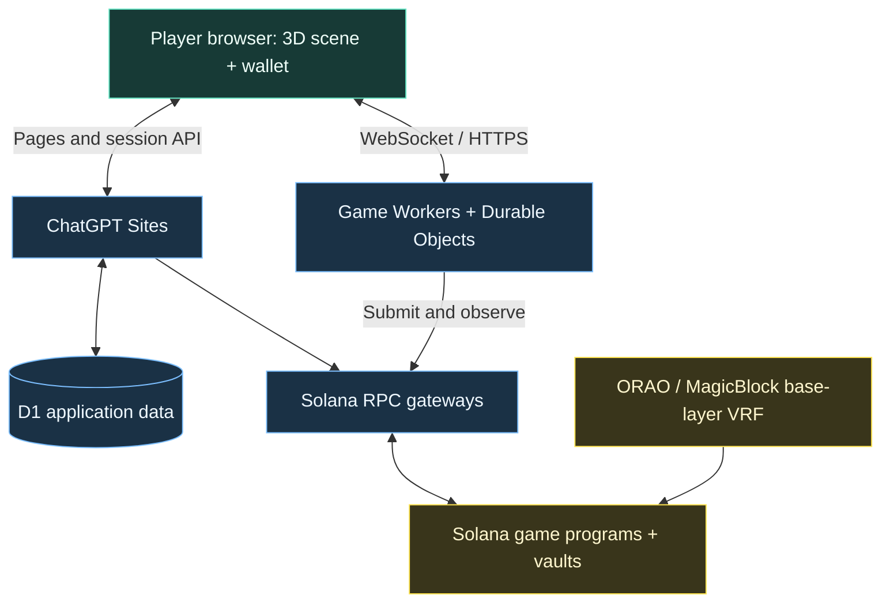

**Perps:** a separate service and execution path, linked through `/perps`.

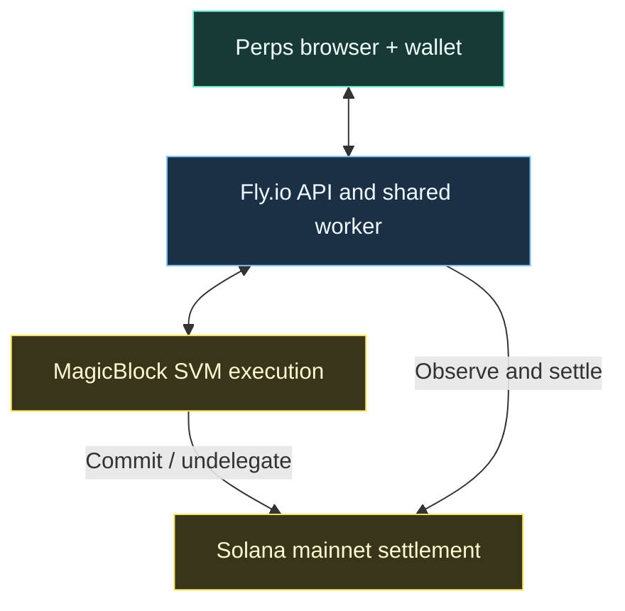

The browser presents and signs; services distribute state and submit permitted work; programs control the corresponding accounts and vaults. Workers and Durable Objects are grouped above for readability. Dice, poker, blackjack, fights, RPS and brackets have separate coordination responsibilities and state namespaces.

| Layer | Responsibilities | Public reference |
| --- | --- | --- |
| Courtyard client | Procedural 3D scene, characters, camera, sound, chat and game controls. A verified wallet bridge is shared by the courtyard games. | [Live courtyard](https://soltoshidice.wtf/) |
| Sites application | Web pages, API/session handling, docs, restricted RPC proxy and D1 app data. D1 is not the token balance ledger. | [Architecture notes](https://soltoshidice.wtf/agents/architecture.md) |
| Cloudflare Workers | Presence/playback, coordinators, signed peer messages, transaction retries and tournament progression. Fee-only keys are separate from upgrade/admin authority. | [Execution boundaries](https://soltoshidice.wtf/verification#execution-boundaries) |
| Solana programs | Funded actions, native deadlines, custody, state transitions, accounting and settlement; exact responsibilities differ by game. | [Program registry](programs.json), [game source](games/), [brackets](brackets/) |
| Perps infrastructure | Separate Fly.io service, shared market worker, registrar, prices, MagicBlock execution and mainnet settlement. Routing does not share courtyard wallet cookies. | [Perps contract](perps/), [delegation evidence](verification/games/perps-delegation.json) |

The AI banker, scene, chat and animations run offchain. They cannot select game randomness or authorize a player's wager. Services affect availability; poker additionally relies on client shuffle verification, and Perps has delegated execution and admission dependencies. “Onchain” describes specific execution and custody boundaries, not every part of the website.

## What can be verified?

| Question | Evidence and scope |
| --- | --- |
| Does deployed code match source? | The [verification hub](https://soltoshidice.wtf/verification) links six program identities, exact source revisions and build-hash evidence. A matching build establishes executable identity, not an audit. |
| Can an outcome be replayed? | [Fairness tools](https://soltoshidice.wtf/verification#run-check) check covered randomness/commitments, rules and historical payments. Poker coverage is partial without the complete shuffle transcript; Perps is oracle-priced trading, not VRF gambling. |
| Was money paid? | Inspect successful native transfers or escrow credits, then any later withdrawal. Displayed profit, awarded chips and completed cash-out are different events. |
| Who can change the programs? | The bank is immutable. Poker, fights, RPS, brackets and Perps retain upgrade authority. P2P games can hold escrow during play or pending withdrawal. See [authority evidence](https://soltoshidice.wtf/verification#authority-status). |

[Verification kit](verification/README.txt) · [Game example manifest](verification/games/index.json) · [Build evidence](VERIFICATION.md) · [IDL and security metadata](metadata/README.md)

## Find your way around

```text
soltoshidice-programs/
├── games/
│   ├── chain/program/       Bank, Cee-lo, blackjack, slots and competitions
│   ├── chain/slots-rules/   Deterministic reel and payout rules
│   ├── chain/rps-program/   Cash RPS challenges
│   ├── fights/             Cash fights and ORAO adapter
│   └── poker/              Hold’em program, rules and cryptography
├── brackets/               Separate RPS/fights tournament source and receipts
├── perps/                  Released Perps contract and pinned build inputs
├── verification/           Read-only fairness, payment and delegation checks
├── metadata/               Public IDLs, security records and receipts
├── evidence/               Dated mainnet deployment and verification records
├── docs/assets/            Screenshots, capture provenance and SVG diagrams
├── scripts/                README diagram generator
├── programs.json           Program addresses, hashes and verified revisions
├── source-provenance.json  Source export and build transformation records
├── verify.sh               Reproducible contract build entrypoint
└── VERIFICATION.md         Full build guide and historical release notes
```

This is a release-source export. It does not contain the complete app, private deployment tools, signing keys or authenticated RPC URLs. Some historical test harnesses refer to fixtures outside the export; that does not prevent reproducing the published program builds using their pinned inputs.

## Reproduce independently

Use Linux x86_64 with Docker and **solana-verify 0.5.2**. The [full build guide](VERIFICATION.md#reproduce-independently) explains the pinned toolchain, exact source revisions and how complete versus zero-trimmed executable hashes are compared.

```sh
bash verify.sh bank
bash verify.sh poker
bash verify.sh fights
bash verify.sh rps
bash verify.sh perps
bash verify.sh brackets
```

These commands build and read chain state; they do not submit transactions. For read-only game evidence checks, inspect the [kit source](verification/README.txt), then run with Node 22+:

```sh
node verification/verify-platform.mjs --all --live
```

The kit reports its scope: five games have covered proof/outcome/payment examples, poker is partial, and Perps trading and payouts are untested by this kit. Exit code 2 represents partial or untested coverage. Example payout sums are not platform-wide totals, and replaying a historical round is not fresh gameplay.

**Continue here:** [Full verification guide](VERIFICATION.md) · [Program records](programs.json) · [Bracket release](brackets/README.md) · [IDL metadata](metadata/README.md) · [Private vulnerability reporting](SECURITY.md)

<details>
<summary>Maintain the visual overview</summary>

The seven flow illustrations are self-contained SVGs in `docs/assets/overview/`. Regenerate them with `node scripts/build-readme-art.mjs` from the repository root. Architecture diagrams are editable Mermaid blocks in this README. [Screenshot provenance](docs/assets/screenshots/README.md) records the capture sources and dates. Keep captions explicit and update release claims against the corresponding receipts.

</details>
